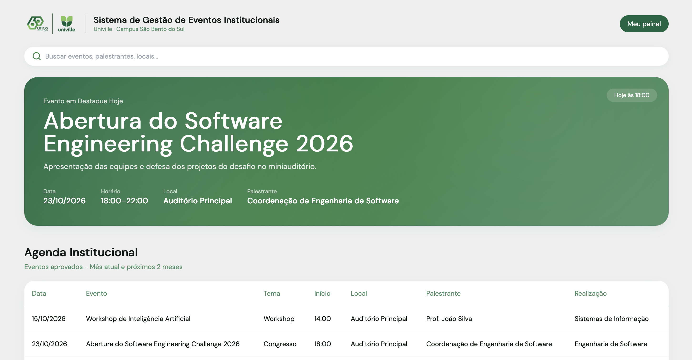

# Sistema de Gestão de Eventos Institucionais — Univille

Aplicação web para **solicitar, analisar, aprovar e divulgar eventos institucionais** da Univille (Campus São Bento do Sul). Ela substitui os formulários manuais por uma plataforma com fluxo de aprovação, agenda pública e relatórios administrativos, e grava todos os dados em um banco SQLite real.

Projeto desenvolvido para o **Software Engineering Challenge 2026 — Univille**.

## Equipe

| | |
|---|---|
| **Nome da equipe** | _[ Eventoville ]_ |
| **Integrantes** | Henry Hamon · _[com IA]_ |



## Funcionalidades

| Perfil | O que pode fazer |
|---|---|
| **Visitante** | Consultar a agenda pública de eventos aprovados (mês atual + 2 meses), com busca instantânea |
| **Solicitante** | Registrar pedidos (rascunho ou envio direto), acompanhar em "Minhas Solicitações", editar/eliminar rascunhos, editar/cancelar pendentes, corrigir e reenviar rejeitados |
| **Administrador** | Fila de análise com filtro por estado; aprovar (publica na hora), rejeitar com justificativa, editar e cancelar aprovados; ver o histórico de auditoria; gerir cadastros; emitir relatórios com exportação CSV; consultar a caixa de saída de e-mails |

### Regras de negócio

- **Conflito de agenda**: não é possível ocupar o mesmo local, na mesma data, com horário sobreposto a um evento **aprovado**. A regra é verificada no envio, em cada edição de pedido pendente ou aprovado e na aprovação. Horários encostados (ex.: 19h–20h e 20h–21h) e locais diferentes são permitidos.
- **Ciclo de vida**: `Rascunho → Aguardando aprovação → Aprovado / Rejeitado`, além de `Cancelado`. As transições são controladas no servidor; um estado enviado pelo navegador é ignorado.
- O **Curso/Coordenação** define o **Centro de Custo** automaticamente, e o **Local** define quais **Recursos** podem ser escolhidos.
- O campo **Solicitante** é texto livre, independente do usuário autenticado que registra o pedido.
- **Sem autocadastro**: apenas o Administrador cria usuários. As senhas são guardadas com hash `scrypt`.
- **Recuperação de senha por e-mail**: o link de redefinição tem validade de 1 hora e só pode ser usado uma vez. Ao redefinir, todas as sessões abertas do usuário são encerradas.
- **Auditoria**: criação, edição, envio, aprovação, rejeição e cancelamento registram quem fez, o quê e quando.

## Tecnologias

| Camada | Tecnologia |
|---|---|
| Backend | Node.js + TypeScript (`tsx`), Express 4, `cookie-parser` |
| Banco de dados | SQLite pelo módulo nativo `node:sqlite`, no arquivo `database.sqlite` |
| Frontend | SolidJS + Vite, Tailwind CSS (CDN), fonte DM Sans |
| Segurança | `node:crypto` (`scrypt` + `timingSafeEqual`), sessões em cookie `httpOnly` persistidas no banco |

O backend fica concentrado em `db.ts` (schema, migração e seed) e `server.ts` (rotas e regras).

## Instalação e execução

**Pré-requisito**: Node.js **22.13 ou superior**, necessário para o `node:sqlite` sem flags. Não é preciso instalar nenhum servidor de banco.

```bash
npm install
npm run dev
```

- Aplicação: **http://localhost:5173**
- API: http://localhost:3000 (o Vite encaminha `/api` para ela)

### Banco de dados

- O arquivo `database.sqlite` fica na raiz e já vem populado com dados fictícios.
- Se o arquivo não existir, o schema e o seed são criados automaticamente na primeira execução.
- Bancos de versões anteriores são migrados automaticamente na inicialização.
- Para recriar o banco do zero com o seed (pare o servidor antes):

```bash
npm run db:reset
```

O seed tem eventos em **todos os estados** e um par preparado para a demonstração de conflito: a "Palestra Noturna", aprovada no Auditório das 19h00 às 20h00, e o rascunho "Workshop Noturno de UX", no mesmo local e data, das 19h30 às 21h00. As datas são calculadas em relação ao dia atual, então a agenda pública sempre tem eventos.

### Versão de produção

```bash
npm run build
npm start          # serve a API e o frontend compilado em http://localhost:3000
```

### Testes

```bash
npm run smoke
```

São 75 verificações de API: autenticação, permissões, máquina de estados, conflitos, cadastros, relatórios/CSV e recuperação de senha. O script sobe um servidor próprio na porta 3999 com um **banco temporário** e não altera o `database.sqlite`.

## Credenciais de teste (fictícias)

| Perfil | E-mail | Senha |
|---|---|---|
| Administrador | `admin@univille.br` | `admin123` |
| Solicitante | `solicitante@univille.br` | `sol123` |
| Solicitante | `maria.souza@univille.br` | `sol123` |

Todos os dados do repositório são fictícios. Não há credenciais reais, tokens nem chaves.

### E-mail em ambiente local

Para funcionar offline e sem credenciais de SMTP, o sistema não usa serviço de e-mail externo. Cada e-mail enviado, como o link de recuperação de senha, é:

1. gravado na tabela `email_outbox` e exibido em **Administrador → Caixa de Saída**, com o link clicável;
2. impresso no log do servidor.

## Roteiro de demonstração

1. Página pública: logo, agenda dos 3 meses e busca.
2. Login como **Solicitante**: "Minhas Solicitações" mostra pedidos em todos os estados.
3. Abrir o rascunho "Workshop Noturno de UX" e clicar em **Enviar para Aprovação**: o envio é bloqueado por conflito com a "Palestra Noturna".
4. Mudar o início para 20:00 e enviar: o pedido passa a **Aguardando aprovação**.
5. Login como **Administrador**: aprovar o pedido na fila. O evento aparece imediatamente na agenda pública.
6. Editar o evento aprovado e recarregar a página (F5): os dados permanecem gravados. O histórico de auditoria aparece no detalhe.
7. Relatórios: filtrar e exportar o CSV.

Roteiro detalhado: [`specs/006-demo-funcional/quickstart.md`](specs/006-demo-funcional/quickstart.md).

## Estrutura

```text
db.ts                  # schema, migração, seed e consulta da agenda pública
server.ts              # rotas, autenticação, máquina de estados, conflitos, CSV
src/
  App.tsx              # roteamento por hash e controle de acesso
  api.ts               # cliente HTTP, sessão e notificações
  components/          # telas (portal, login, formulário, fila, cadastros, relatórios...)
public/univille-logo.png
scripts/reset-db.ts    # recria o banco
scripts/smoke.sh       # testes de API em banco temporário
specs/                 # especificações SDD (GitHub Spec Kit), em português
docs/mocks-html/       # mock visual de referência
```

## Componentes reutilizados e ferramentas de IA

**Componentes e recursos de terceiros:**

- [SolidJS](https://www.solidjs.com/), [Vite](https://vitejs.dev/), [Express](https://expressjs.com/), [cookie-parser](https://github.com/expressjs/cookie-parser): bibliotecas open source via npm.
- [Tailwind CSS](https://tailwindcss.com/) (CDN) e a fonte [DM Sans](https://fontsource.org/fonts/dm-sans) (Fontsource/jsDelivr).
- Mock visual em `docs/mocks-html/mock.html`, gerado com o Qwen Design: dele vieram a paleta, os cartões e a barra lateral. O conteúdo genérico do mock não foi usado.
- Logo da Univille: arquivo público do site institucional (univille.edu.br), usado para identificar a instituição.

**Ferramentas de IA utilizadas:**

- **Qwen Design** (online): criação do layout e do mock visual de referência (`docs/mocks-html/mock.html`).
- **OpenCode** com o modelo **BigPickle**: assistente de código no desenvolvimento, com os comandos do Spec Kit em `.opencode/`.
- **GitHub Spec Kit**: desenvolvimento orientado a especificação (SDD), com o fluxo constituição → especificação → plano → tarefas registrado em `specs/` e `.specify/`.

Nenhuma plataforma de geração integral de aplicações (como Lovable ou Bolt) foi usada.

## Licença

[MIT](LICENSE)
